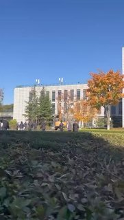

+++
title = ""
date = 2026-11-09T11:10:20+00:00
description = "11月9日，陕西西安沣东新城。 有人驾驶挖掘机，冲进当地政务服务中心，不断拆毁中心内的建筑，周围的公务员们束手无策 ，只能在一旁拍照。"

[taxonomies]
days = ["2026-11-09"]

[extra]
id = 30123
day = "2026-11-09"
tg_url = "https://t.me/pelosi3/30123"
og_image = "01.jpg"
next_id = 30125
next_title = ""
next_body = "你支的法官是五年级班长直招吗 小孩似的"
prev_id = 30122
prev_title = ""
prev_body = "【AI安全倡导组织将中期选举视为重大胜利】\n据美国财经媒体Semafor，一份备忘录显示，与Anthropic有关联的Public First Action及其附属超级政治行动委员会认为，AI安全倡导者已将美国中期选举视为一场重大胜利，正在制定下一阶段的行动计划。获得Anthropic大量资金支持、主张为人工智能设置监管护栏的Public First表示，支持AI发展的头号超级政治行动委员会Leading the Future已经“遭遇惨败”。但该组织同时警告称：“如果将本轮选举以及Leading the Future的衰落解读为大型科技企业AI政治布局的终结，那将是一个错误。”该组织为2027年制定的目标包括：推动国会通过不会排除各州自行立法权的AI法律、支持主张AI安全监管的候选人、以及利用目前账上持有的3000万美元资金，反驳支持AI发展的阵营所传递的信息。"
views = 6380
ids = [30123]
+++

11月9日，陕西西安沣东新城。  
有人驾驶挖掘机，冲进当地政务服务中心，不断拆毁中心内的建筑，周围的公务员们束手无策 ，只能在一旁拍照。

*▶ 视频 — 2:14*
