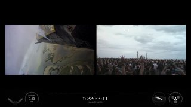

+++
title = ""
date = 2026-11-15T02:09:45+00:00
description = "人类的文明。马斯克的 SpaceX 星舰，今早完成第 15 次综合试飞，在太空释放 26 颗星链 V3 卫星，飞行约 22.5 小时后，从轨道返回，被地面发射塔的筷子臂成功捕获。 这是人类历史上，首次从太空轨道返回，并被塔臂抓住的星舰上层飞船。"

[taxonomies]
days = ["2026-11-15"]
tags = ["video"]

[extra]
id = 30245
day = "2026-11-15"
tg_url = "https://t.me/pelosi3/30245"
og_image = "02.jpg"
next_id = 30247
next_title = ""
next_body = "华盛顿邮报认为，黄仁勋出轨事件不仅是个人丑闻，更是美国政府内部与国会两党“对华鹰派”联手瓦解黄仁勋在华盛顿政治影响力、夺回对华芯片出口政策主导权的关键转折点。卢比奥扮演了导火索制造者与幕后推手的关键角色。\n白宫国安团队及国会两党强硬派将人工智能芯片视为中美竞争的核心战略资产，强烈反对放宽出口。黄仁勋此前曾在播客中公开痛批“对华鹰派”不爱国，彻底激怒了华盛顿的政客与智库群体。\n国务卿兼国家安全顾问卢比奥根据中央情报局CIA的情报报告，用更具断言性的措辞撰写备忘录，警告特朗普注意黄仁勋与一名疑似中国情报线人的密切关系。备忘录内容随后被媒体泄露，最终引爆舆论危机。\n长期以来，特朗普政府的国家安全团队对黄仁勋左右总统的芯片出口政策极为不满。卢比奥的出手成功打掉了黄仁勋在白宫的政治影响力，帮助政府内部和国会的“对华鹰派”夺回了制定对华科技封锁政策的主导权。\n事情曝光后，卢比奥在G7峰会上多次拒绝回应记者关于他在向白宫告发一事中所起作用的提问，仅用“美国永远会按照最符合美国利益的方式行事，我为美国人民服务”来回应，在避免与特朗普公开产生裂痕的同时，坚定站稳了对华强硬立场。"
prev_id = 30244
prev_title = ""
prev_body = "【特朗普：举后股市蒸发3万亿美元，全球投资者都不认可选举结果】\n美国总统特朗普：有没有人注意到，选举结束后，股市市值立即蒸发了3万亿美元？换句话说，世界各地的投资者都不喜欢选举日发生的事情。不过，不必担心，股市此后已经回升，美国很快就会变得比以往任何时候都更加伟大！"
views = 4930
ids = [30245]
+++

人类的文明。马斯克的 SpaceX 星舰，今早完成第 15 次综合试飞，在太空释放 26 颗星链 V3 卫星，飞行约 22.5 小时后，从轨道返回，被地面发射塔的筷子臂成功捕获。  

这是人类历史上，首次从太空轨道返回，并被塔臂抓住的星舰上层飞船。

{{ video_ext(url="https://github.com/zooanan452-creator/telegram_channel_to_static_website/releases/download/media/30245-01.mp4") }}

*▶ 视频 — 0:35*

{{ tag(t="video") }}
