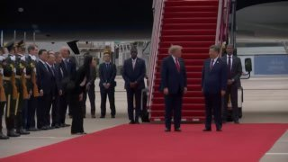

+++
title = ""
date = 2026-11-18T09:23:56+00:00
description = "对比 5 月那次特朗普访华，这次由中国领导人亲自接机。 本次没有企业家跟随在特朗普身后，而是特朗普本人单独下飞机，在接机仪式结束后，乘车离开。"

[taxonomies]
days = ["2026-11-18"]

[extra]
id = 30302
day = "2026-11-18"
tg_url = "https://t.me/pelosi3/30302"
og_image = "01.jpg"
next_id = 30303
next_title = ""
next_body = "BBC 现场记者证实，特朗普和美方团队，已入住深圳东海朗廷酒店。而昨天普京和俄方团队，入住的是深圳前海康莱德酒店。\n两方人马，明天会面和开会的地方，则是麒麟山庄。\n东海朗廷、前海康莱德、麒麟山庄，中美俄严选。"
prev_id = 30299
prev_title = ""
prev_body = "腾讯控股第三季度营收2073.4亿元，预估2105.3亿元\n净利润636.1亿元，预估576.1亿元\n第三季度资本支出814.3亿元，预估554亿元人民币\n录得负自由现金流691亿元，经营现金流包括大额算力采购预付款，用于支持Hy系列模型升级、WorkBuddy推理需求，以及各项产品与服务的AI能力建设。若剔除算力采购的预付款，自由现金流将转正至169亿元。\n按大语言模型词元消耗量计，WorkBuddy已成为中国使用量最高的AI产品，每日超千万的用户合计消耗100万亿以上词元。"
views = 6290
ids = [30302]
+++

对比 5 月那次特朗普访华，这次由中国领导人亲自接机。  

本次没有企业家跟随在特朗普身后，而是特朗普本人单独下飞机，在接机仪式结束后，乘车离开。

*▶ 视频 — 0:52*
