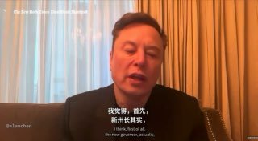

+++
title = ""
date = 2026-11-19T02:37:10+00:00
description = "老马今天说，政治选举上花了这么多钱没换来什么，觉得自己挺傻的。要是能重来，他会少花点。 这是他在纽约时报DealBook峰会上讲的。纽约时报选举前统计，这次中期选举他至少花了4.74亿美元。他说，自己真正的目标是让共和党在参议院拿到51席，结果失败了，共和党被打得很惨。 他也说，美国选举显然不能只靠烧钱。钱可以砸很多，效果却可能很小。这次大概就是这样。 来源：纽约时报DealBook峰会"

[taxonomies]
days = ["2026-11-19"]

[extra]
id = 30322
day = "2026-11-19"
tg_url = "https://t.me/pelosi3/30322"
og_image = "01.jpg"
next_id = 30323
next_title = ""
next_body = "美国总统特朗普：不会在乌克兰缺席的情况下达成任何协议。"
prev_id = 30321
prev_title = ""
prev_body = "【以媒称以色列考虑未来几天内打伊朗】\n据多家伊朗媒体11月18日报道，伊朗军队总司令哈塔米当天表示，任何新的敌人的袭击都将受到不受地理范围限制的强有力的回应。哈塔米称，伊方正在密切监视敌方的行动，同时不断加强防御准备。当天，据以色列12频道援引消息人士的话报道，以色列正考虑在未来几天内对伊朗采取军事行动。"
views = 6000
ids = [30322]
+++

老马今天说，政治选举上花了这么多钱没换来什么，觉得自己挺傻的。要是能重来，他会少花点。  

这是他在纽约时报DealBook峰会上讲的。纽约时报选举前统计，这次中期选举他至少花了4.74亿美元。他说，自己真正的目标是让共和党在参议院拿到51席，结果失败了，共和党被打得很惨。  

他也说，美国选举显然不能只靠烧钱。钱可以砸很多，效果却可能很小。这次大概就是这样。  

来源：纽约时报DealBook峰会

*▶ 视频 — 3:10*
