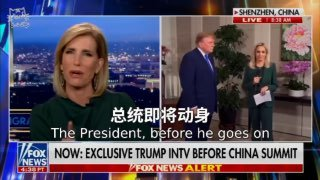

+++
title = ""
date = 2026-11-19T11:59:31+00:00
description = "会晤习近平、普京前，特朗普在深圳称中俄本是“天然敌人”，还说“中国需要俄罗斯的土地” 11月19日上午，特朗普在深圳接受福克斯新闻采访。被问到为何要同时会见习近平和普京时，他说中俄已经在合作，接着称两国本是“天然敌人”。 他拿中国约14亿人口与俄罗斯横跨11个时区作比较，说“中国需要土地”。…"

[taxonomies]
days = ["2026-11-19"]

[extra]
id = 30340
day = "2026-11-19"
tg_url = "https://t.me/pelosi3/30340"
og_image = "01.jpg"
next_id = 30341
next_title = ""
next_body = "【特朗普：美中俄三方应共同防止核扩散，避免核武器给人类带来灾难】\n11月19日下午，国家主席习近平在深圳同俄罗斯总统普京、美国总统特朗普举行中俄美元首会晤。三国元首围绕“维护世界和平，促进大国关系战略稳定”主题进行深入讨论。特朗普表示，美中俄三国元首会晤举世瞩目、非常重要，创造了历史。三国都是有核国，对维护世界和平稳定负有特殊重要的责任。三方应共同防止核扩散，避免核武器给人类带来灾难。维护稳定、实现和平需要对话，任何问题都应通过对话解决。我期待同习近平主席和普京总统一道，更好地保护我们的地球，使未来更安全。"
prev_id = 30338
prev_title = ""
prev_body = "除了欢迎仪式规格偏低，网友还发现，高市早苗下机时舷梯明显比舱门矮一大截，落差远大于其他领导人。"
views = 5130
ids = [30340]
+++

会晤习近平、普京前，特朗普在深圳称中俄本是“天然敌人”，还说“中国需要俄罗斯的土地”  

11月19日上午，特朗普在深圳接受福克斯新闻采访。被问到为何要同时会见习近平和普京时，他说中俄已经在合作，接着称两国本是“天然敌人”。  
他拿中国约14亿人口与俄罗斯横跨11个时区作比较，说“中国需要土地”。  

特朗普此前也拿两国的人口和国土作过比较。2025年8月在阿拉斯加见完普京后，他说得更直接，称“中国需要俄罗斯的土地”，并把这视为中俄之间潜在的摩擦。

*▶ 视频 — 1:12*
