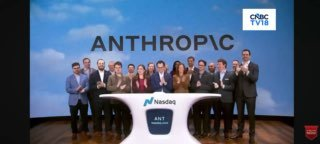

+++
title = ""
date = 2026-11-20T04:37:20+00:00
description = "看到帖子讨论说，anthropic 上市敲钟的音乐很诡异，配合上 Dario 和一致的鼓掌，有一种 AI 生成视频的诡异感"

[taxonomies]
days = ["2026-11-20"]

[extra]
id = 30359
day = "2026-11-20"
tg_url = "https://t.me/pelosi3/30359"
og_image = "01.jpg"
next_id = 30360
next_title = ""
next_body = "摩根士丹利关于亚太峰会的研报，其他部分就先不管了，关于中国的部分看一下：\n中国复苏仍不均衡，出口和高科技投资韧性强，内需偏弱。\n预计2027年增长约4.4%，通胀约0.7%。\n财政适度收紧，支出聚焦基础设施和产业升级。\n最后这句应该会是未来一段时间的主旋律，而且很多政策应该都会放缓。\n为什么放缓？不应该刺激么？\n我也不知道啊，我只知道现象，不知道原因。"
prev_id = 30358
prev_title = ""
prev_body = "昨晚 Anthropic 上市后，最惨的是海外机构和散户们。彭博和 WSJ 爆料称，当时约 1200 家机构下了 ANT 打新认购单，结果超过一半都没拿到。配售明显偏向跟 Anthropic 有老关系的机构。\n之后更是爆出，Anthropic 招股书写的是最多 20% 给散户，最后打新火爆的情况下，只给了约 15%。\n要知道当时 SpaceX，即使特别难打新，额度抢疯，散户实际也拿到了约 20% 的配售。\n其中澳洲最惨，AFR 说澳洲投资者平均只拿到申购量的 7%，标题直接用了 Brutal，意为残酷。\n最终如二级市场所表现的那样，ANT 直接高开低走了，NBC 称员工首日获准卖出 10% 持股，也推高了抛压。"
views = 4640
ids = [30359]
+++

看到帖子讨论说，anthropic 上市敲钟的音乐很诡异，配合上 Dario 和一致的鼓掌，有一种 AI 生成视频的诡异感

*▶ 视频 — 0:43*
