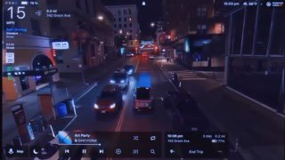

+++
title = ""
date = 2026-11-22T10:08:28+00:00
description = "太炫酷了。特斯拉今早突然向部分早期体验用户，推送 FSD V15 新辅助驾驶版本，整个端到端驾驶模型全面升级，最抢眼的是一个新的画面功能，叫现实视图。 它通过全车的摄像头结合之前训练的算法，使驾驶界面从过去的仅显示汽车、人、路障图标等，变成 AI 实时街景。"

[taxonomies]
days = ["2026-11-22"]

[extra]
id = 30384
day = "2026-11-22"
tg_url = "https://t.me/pelosi3/30384"
og_image = "01.jpg"
next_id = 30385
next_title = ""
next_body = "下周主要的聚焦，也有软银和孙正义，因为周末市场传出孙正义曾探讨以 1 万亿美元收购 SK 海力士，但软银回应称已不再积极推进该交易，市场担心老哥还有更多的计划，正被叫停和终止。\n在今年 6 月，孙正义高调认为 AI 这波可能比互联网泡沫大 50 倍，随后软银股价达到历史新高。\n但等到 6 月底，市场传出他重仓押注的 OpenAI，可能把上市推迟到 2027 年，预计落后于 Anthropic 之后，原本押注该预期交易的投资者，纷纷撤退。\n而到 7 月，他们旗下的 Arm 财报警告，内存涨价拖累手机版税，软银跟着探底。\n8 月同时赶上，公司净利润大幅回撤，之后 9 月确定 OpenAI 本年度不再上市，致使软银再遭打击。\n真正的连续下跌是 10、11 月开始，既有全球 AI 股抛售，也有软银自己的麻烦。在 11 月初，软银收购 ABB 机器人业务的中国部分被叫停，同一天马斯克突然称，软银正在违约，为数据中心建设投资的燃气轮机订单。\n之后几天的财报显示，软银确实为数据中心发电设备计提了约 37 亿美元损失。WSJ 称，软银预订的燃气轮机远超实际需要，甚至取消了多余的部分。\n结合这周末的不再积极考虑收购 SK 海力士交易传闻，孙正义的软银，似乎还有更多市场不知道的计划，正被叫停和终止。"
prev_id = 30382
prev_title = ""
prev_body = "11月21日，人民日报发文《唱空中国经济者终会落空！》，痛批“境外媒体和机构围绕中国经济频频发难”。"
views = 5740
ids = [30384]
+++

太炫酷了。特斯拉今早突然向部分早期体验用户，推送 FSD V15 新辅助驾驶版本，整个端到端驾驶模型全面升级，最抢眼的是一个新的画面功能，叫现实视图。  

它通过全车的摄像头结合之前训练的算法，使驾驶界面从过去的仅显示汽车、人、路障图标等，变成 AI 实时街景。

*▶ 视频 — 0:51*
