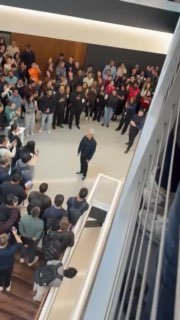

+++
title = ""
date = 2026-11-23T23:58:30+00:00
description = "黄仁勋在今早，回到了位于加州的英伟达总部。数百名员工聚集在周围，欢呼他的回归，甚至有位员工兴奋的上前与他拥抱，大家全都在高喊 Jensen！ 他现场表示，感谢大家给我第二次机会，我会成为更好的 CEO。我犯了非常严重的错误，会努力重新站起来。"

[taxonomies]
days = ["2026-11-23"]

[extra]
id = 30420
day = "2026-11-23"
tg_url = "https://t.me/pelosi3/30420"
og_image = "01.jpg"
next_id = 30421
next_title = ""
next_body = "【美股连跌忧心数日 特朗普认定止跌之法是黄仁勋】\n据CNN报道，上周美国股市抛售持续加剧，令特朗普连续数日忧心忡忡，最终他认定，阻止股市继续下跌只有一个办法：让黄仁勋重新执掌英伟达。多名知情人士透露，特朗普上周晚些时候作出这一判断，随后亲自策划了一场史无前例的白宫施压行动，试图说服这家科技巨头恢复黄仁勋的CEO职务，而这距离黄仁勋迫于压力辞职仅过去11天。"
prev_id = 30419
prev_title = ""
prev_body = "【做空英伟达的基金在暴跌91%后停牌】\n据华尔街日报，对于做空英伟达的投资者而言，今天上午的日子可不好过。在欧洲上市的一只ETF——该基金提供针对英伟达的三倍杠杆做空敞口——在美股开盘后不久便暴跌91%，随后被暂停交易。"
views = 5720
ids = [30420]
+++

黄仁勋在今早，回到了位于加州的英伟达总部。数百名员工聚集在周围，欢呼他的回归，甚至有位员工兴奋的上前与他拥抱，大家全都在高喊 Jensen！  

他现场表示，感谢大家给我第二次机会，我会成为更好的 CEO。我犯了非常严重的错误，会努力重新站起来。

*▶ 视频 — 0:50*
